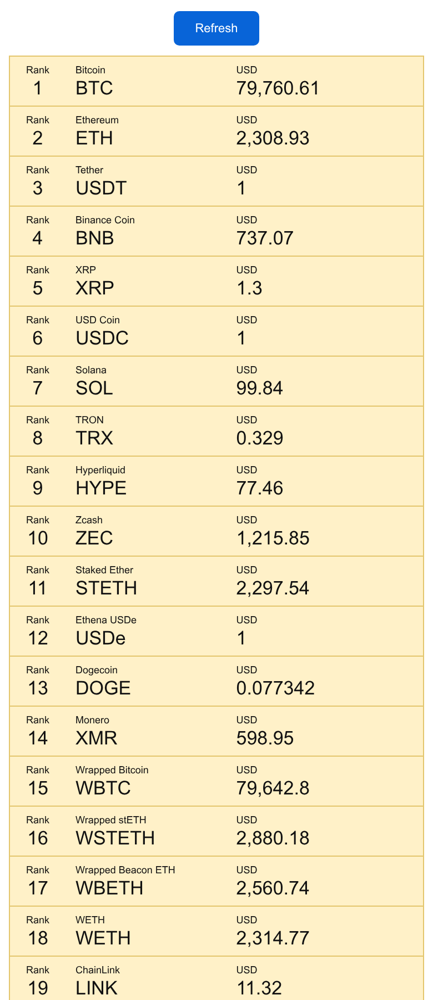

# Tugas 3 – Aplikasi Daftar Cryptocurrency (Ionic + Vue)

Aplikasi mobile sederhana untuk menampilkan daftar cryptocurrency di dunia yang datanya diambil secara online dari [Coinlore API](https://api.coinlore.net/api/tickers/). Data ditampilkan dalam bentuk list dengan kolom **rank**, **name**, **symbol**, dan **price_usd**.



## Fitur

- Mengambil data dari `https://api.coinlore.net/api/tickers/` saat halaman dibuka.
- Menampilkan `rank`, `name`, `symbol`, dan `price_usd` (format ribuan & desimal).
- Tombol **Refresh** untuk memuat ulang data.
- Indikator loading dan pesan error jika data gagal dimuat.

## Teknologi

- Ionic 9 + Vue 3 + TypeScript
- Vite
- Capacitor (siap dijalankan di Android/iOS)

## Cara Menjalankan

```bash
npm install
npm run dev
```

Buka `http://localhost:5173/home` di browser (gunakan mode mobile pada DevTools).

Build untuk perangkat:

```bash
npm run build
npx cap add android
npx cap sync
npx cap open android
```

## Penjelasan File

| File | Keterangan |
| --- | --- |
| `src/views/HomePage.vue` | **File utama**. Berisi logika `fetch` ke API, state (data, loading, error), format harga, serta tampilan list cryptocurrency. |
| `src/router/index.ts` | Mengatur routing; halaman `/` diarahkan ke `/home` yang menampilkan `HomePage.vue`. |
| `src/App.vue` | Komponen root yang membungkus aplikasi dengan `ion-app` dan `ion-router-outlet`. |
| `src/main.ts` | Entry point aplikasi: inisialisasi Vue, Ionic, router, dan CSS tema. |
| `src/theme/variables.css` | Variabel warna/tema Ionic. |
| `capacitor.config.ts` | Konfigurasi Capacitor (appId, appName, `webDir: dist`). |
| `package.json` | Daftar dependency dan script (`dev`, `build`, dll). |
| `docs/screenshot.png` | Screenshot tampilan aplikasi. |

## Source Code Utama – `src/views/HomePage.vue`

```vue
<script setup lang="ts">
import { onMounted, onUnmounted, ref } from 'vue';
import { IonContent, IonPage } from '@ionic/vue';

interface Currency {
  id: string;
  name: string;
  symbol: string;
  rank: string;
  price_usd: string;
}

interface CurrencyResponse {
  data: Currency[];
}

const API_URL = 'https://api.coinlore.net/api/tickers/';
const currencies = ref<Currency[]>([]);
const isLoading = ref(false);
const errorMessage = ref('');
let activeController: AbortController | null = null;

const formatPrice = (price: string) => {
  const numericPrice = Number(price);

  if (!Number.isFinite(numericPrice)) {
    return price;
  }

  return numericPrice.toLocaleString('en-US', {
    minimumFractionDigits: 0,
    maximumFractionDigits: 6,
  });
};

const loadCurrencies = async () => {
  activeController?.abort();
  const controller = new AbortController();
  activeController = controller;
  isLoading.value = true;
  errorMessage.value = '';

  try {
    const response = await fetch(API_URL, { signal: controller.signal });

    if (!response.ok) {
      throw new Error(`Request failed with status ${response.status}`);
    }

    const payload: unknown = await response.json();

    if (
      typeof payload !== 'object' ||
      payload === null ||
      !('data' in payload) ||
      !Array.isArray((payload as CurrencyResponse).data)
    ) {
      throw new Error('The API returned an invalid response.');
    }

    currencies.value = (payload as CurrencyResponse).data;
  } catch (error) {
    if (error instanceof DOMException && error.name === 'AbortError') {
      return;
    }

    errorMessage.value = 'Unable to load currency data. Please try again.';
  } finally {
    if (activeController === controller) {
      isLoading.value = false;
      activeController = null;
    }
  }
};

onMounted(loadCurrencies);
onUnmounted(() => activeController?.abort());
</script>

<template>
  <ion-page>
    <ion-content>
      <main class="currency-page">
        <button class="refresh-button" type="button" :disabled="isLoading" @click="loadCurrencies">
          {{ isLoading ? 'Loading...' : 'Refresh' }}
        </button>

        <p v-if="errorMessage" class="status-message error-message" role="alert">
          {{ errorMessage }}
        </p>
        <p v-else-if="isLoading && currencies.length === 0" class="status-message">
          Loading currency data...
        </p>

        <section v-else-if="currencies.length > 0" class="currency-list" aria-label="Currency list">
          <article v-for="currency in currencies" :key="currency.id" class="currency-card">
            <div class="currency-column rank-column">
              <span class="column-label">Rank</span>
              <span class="rank-value">{{ currency.rank }}</span>
            </div>
            <div class="currency-column name-column">
              <span class="column-label">{{ currency.name }}</span>
              <span class="symbol-value">{{ currency.symbol }}</span>
            </div>
            <div class="currency-column price-column">
              <span class="column-label">USD</span>
              <span class="price-value">{{ formatPrice(currency.price_usd) }}</span>
            </div>
          </article>
        </section>

        <p v-else class="status-message">No currency data available.</p>
      </main>
    </ion-content>
  </ion-page>
</template>
```

> CSS lengkap (`.currency-card`, `.refresh-button`, dll.) ada di bagian `<style scoped>` pada file `src/views/HomePage.vue`.

## Cara Kerja Singkat

1. Saat halaman dimuat, `onMounted` memanggil `loadCurrencies()`.
2. `fetch(API_URL)` mengambil data JSON dari Coinlore.
3. Respons divalidasi, lalu array `data` disimpan ke `currencies`.
4. `v-for` merender setiap item menjadi satu baris berisi rank, name + symbol, dan harga USD.
5. Tombol **Refresh** memanggil ulang fungsi yang sama untuk memperbarui data.
